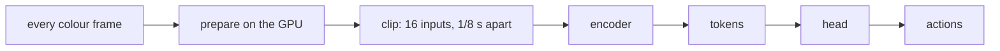

# How the node works

This page describes the encoder, how xblick-vjepa2 forms a clip from a camera stream, what the tokens are and
how a head reads them. It also explains the options, the use from Python and the tests.

## The encoder and its heads

The encoder of V-JEPA 2 is a ViT-L, a vision transformer with 300 million parameters. It takes a clip of 16 frames
at 256 x 256 pixels and cuts it into 2048 *tubelets*. A tubelet is a block of 2 frames x 16 x 16 pixels. The encoder
turns each tubelet into a token of 1024 values, and every token has seen the whole clip.

Meta uses the encoder frozen. A task gets a small *attentive head*, which Meta trains on the tokens. The head is a
learned query that attends over all tokens, followed by a linear layer. Meta's head for Something-Something v2 is
such a head. It has 174 classes of hand-object actions, for example "Putting [something] on a surface" and
"Opening [something]".

The encoder in the SSv2 checkpoint is exactly the pretrained encoder. Meta trains only the heads, and the encoder
weights of the checkpoint are bit-identical to those of `vjepa2-vitl-fpc64-256`. The node drops the predictor of
the pretraining, because features do not need it.

## From frames to a clip



**Preparation.** The node turns every colour frame into the input of the model when the frame arrives
(`model.prepare`). It scales the short side to 292 pixels, cuts out the centre 256 x 256 and normalises with
ImageNet's mean and deviation. This equals the result of transformers' `VJEPA2VideoProcessor`. The work happens on
the GPU. The model does not see the sides of a wide image.

**The clip.** A camera delivers frames at its own rate, and the model expects a fixed time between its frames.
`clip.py` solves this by the stamps. A clip consists of `--frames` frames that are `1/--fps` seconds apart and end
at the newest frame. The defaults are 16 frames at 8 frames per second, which is 2 s. For each of these times the
node takes the camera frame with the nearest stamp, whatever the rate of the camera is. A camera that is slower
than the clip supplies a frame twice.

| Case | What the node does |
| --- | --- |
| A time has no frame within one period (`1/--fps`). | The stream has a gap, or it has not lasted for a clip yet. The node forms no clip and counts the frame. |
| A stamp is older than the newest by more than a clip. | A replay started over, or the clock of the camera was reset. The node starts the clip anew and counts a restart. |

The node keeps up to 30 arrived frames until it has prepared them. This is one second at 30 frames per second while
the encoder works.

**One clip at a time.** The node encodes the newest clip and waits until the GPU has finished it. It then takes the
clip that is newest at that moment. Clips therefore never accumulate on the GPU.

## The tokens

| Property | Value |
| --- | --- |
| Shape | N x 1024, one row per token |
| N | frames / 2 x 16 x 16, which is 2048 for 16 frames |
| Order | time, row, column, the oldest first. `VJEPA2AttentivePooler` of transformers takes them in this order. |
| Number format | float16 |
| Stream encoding | `16FC1`, without a compressed form |
| Transport | `cuda` for readers on the same host, otherwise `raw` with 4 MB per clip |

The node computes the tokens for every clip, and it publishes them only while a subscriber exists. With the `cuda`
transport the tokens stay in a *CUDA ring*, which is a ring in GPU memory. A reader on the same host reads them
there without a copy to the CPU.

A head reads the tokens as they arrive. The topic name is an example.

```python
import torch, xblick as db
tokens = db.ImageSubscriber(session, "robot/camera/vjepa2/tokens", local="cuda")
frame = tokens.latest(timeout=1.0)
x = torch.as_tensor(frame.image, device="cuda")[None]   # (1, 2048, 1024) float16, as VJEPA2AttentivePooler takes it
```

`score` in the actions message is the probability of the class, a softmax over all classes.

## Options

The README lists all options. Four of them need an explanation.

**`--frames` and `--fps`.** `--frames` must be even and at least 2, because two frames form one time step of the
tokens. The node prints a note when the head was trained on another number of frames.

**`--checkpoint`.** The value is a name from `model.CHECKPOINTS` or a directory. `ssv2` is the only name, and
`tools/setup.sh` stores it in `weights/ssv2`. A directory must contain `config.json` and `model.safetensors` of a
`VJEPA2ForVideoClassification`.

**`--max-hz`.** This option limits the clips per second. The node encodes a clip when the stamp of its newest frame
lies in a later period of `1/max-hz` than the last encoded clip. The node still prepares every frame, because a
clip needs its frames `1/--fps` apart. It does not encode the clips that it leaves out, which saves GPU time. The
diagnostics count them and state the rate in effect. Without the option the node encodes every clip.

**`--local`.** This option selects how frames of a camera on the same host reach the node. With `auto`, the node
reads the camera's CUDA ring when the ring is on the node's GPU (`--device`). Otherwise it reads the host ring in
shared memory. `shm` and `cuda` force one of the two. With `cuda`, the node stops when the camera offers no CUDA
ring. The start log and every report name the transport of the stream.

The node also has Durchblick's session options `--connect`, `--listen`, `--zenoh-mode` and `--config`. Without
them it connects to the Zenoh router of the PC.

## Use from Python

You can use the model without Durchblick (`model.py`).

| Call | Input | Result |
| --- | --- | --- |
| `VJepa2("ssv2").prepare(rgb)` | one frame, an (H, W, 3) uint8 torch tensor on the GPU | the input of the model for this frame |
| `encode(inputs)` | the inputs of one clip, the oldest first | the tokens |
| `classify(tokens)` | the tokens | the probabilities of `labels` |

## Tests

```bash
.venv/bin/python -m pytest -q
```

| File | Needs | What it checks |
| --- | --- | --- |
| `tests/test_clip.py` | CPU | which frames form a clip at camera rates above and below the rate of the clip, gaps, the start, a stream that starts over |
| `tests/test_model.py` | a CUDA device and `weights/ssv2` | the inputs equal those of transformers' `VJEPA2VideoProcessor` for four frame sizes. The tokens have the expected shape. The probabilities equal those of transformers' `VJEPA2ForVideoClassification` on the same inputs. |

torchvision is a development dependency only. The video processor of transformers needs it in the tests.
